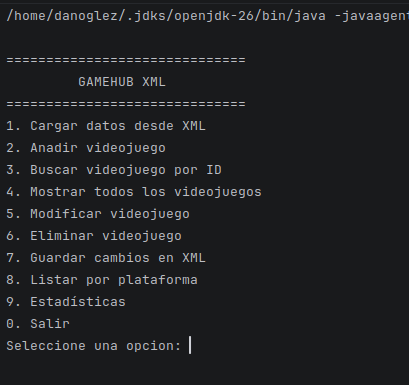
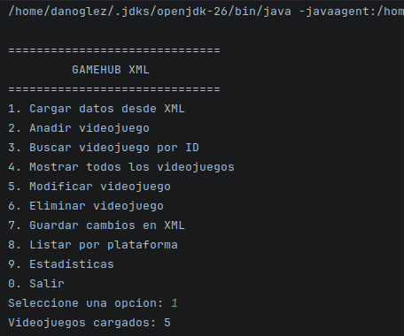
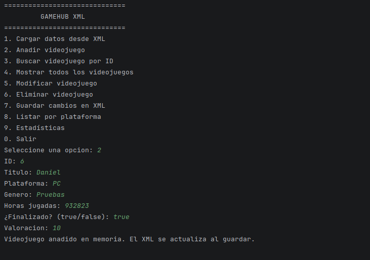
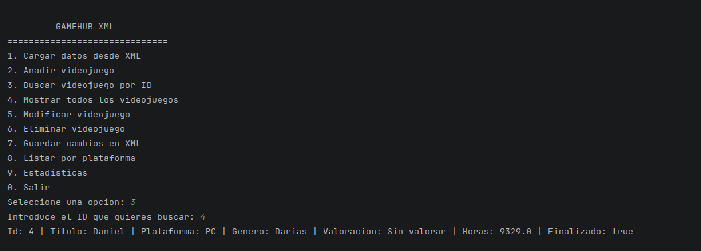
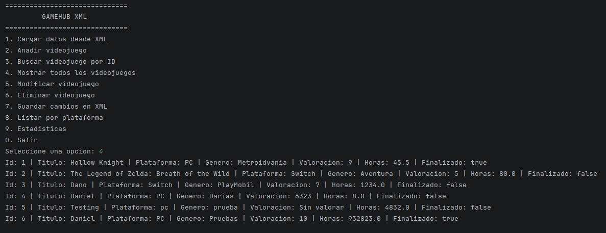
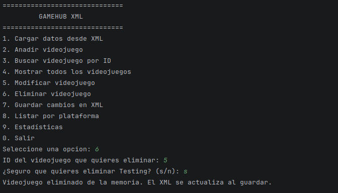
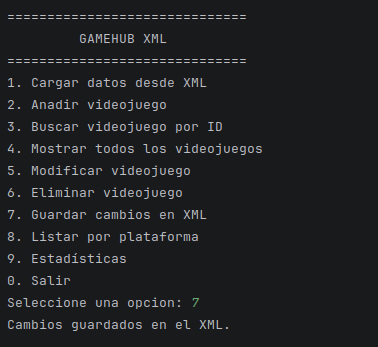
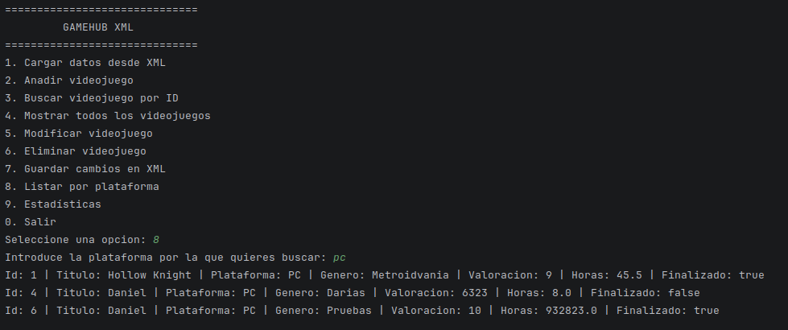
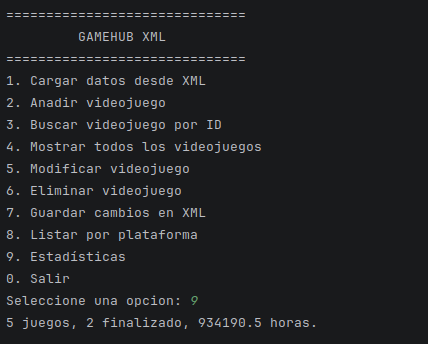

# GameHub XML – AE1.3 CRUD con fichero XML

Aplicación de consola para gestionar un catálogo de videojuegos. El CRUD trabaja sobre un `ArrayList` en memoria. El fichero `data/videojuegos.xml` solo se lee al cargar y se escribe al guardar (o al salir, si se confirma).

---

## 1. Qué hace la aplicación

El menú se repite hasta que se elige salir.

```text
==============================
         GAMEHUB XML
==============================
1. Cargar datos desde XML
2. Anadir videojuego
3. Buscar videojuego por ID
4. Mostrar todos los videojuegos
5. Modificar videojuego
6. Eliminar videojuego
7. Guardar cambios en XML
8. Listar por plataforma
9. Estadísticas
0. Salir
```

1. Lee `data/videojuegos.xml`. Si no existe, lo crea con `<gamehub>` y `<videojuegos>` vacíos e informa de cuántos juegos se han cargado.
2. Pide los datos y los añade a la lista. No admite un id repetido, un id menor o igual que 0, título, plataforma o género vacíos, ni horas negativas.
3. Busca ese id en la lista de memoria y muestra el juego, o avisa si no está.
4. Muestra todos los juegos ordenados por id. Si no hay ninguno, indica que el catálogo está vacío.
5. Cambia título, plataforma, género, horas, finalizado y valoración. El id no se modifica.
6. Pide confirmación y, si se acepta, quita el juego de la lista.
7. Vuelca la lista al XML, en UTF-8 y con sangría.
8. Pide una plataforma y muestra solo los juegos de esa plataforma. No distingue mayúsculas.
9. Muestra cuántos juegos hay, cuántos están finalizados y la suma de horas.
0. Si hay cambios sin guardar, pregunta si se escriben en el XML antes de cerrar.

Alta, modificación y baja marcan cambios pendientes. Cargar y guardar los quitan. El XML no se toca en cada alta.

Cada videojuego guarda `id`, `titulo`, `plataforma`, `genero`, `valoracion`, `horasJugadas` y `finalizado`. La valoración `0` se muestra como `Sin valorar`.

---

## 2. Cómo está aplicado el MVC

`Main` no contiene el menú ni abre el fichero. Solo crea el servicio, la vista y el controlador:

```java
public static void main(String[] args) {
    VideojuegoService servicio = new VideojuegoService();

    try (IVista vista = new VistaTexto()) {
        Controlador controlador = new Controlador(vista, servicio);
        controlador.ejecutar();
    }
}
```

```
XML/
├── data/videojuegos.xml
├── capturas/
├── src/main/java/dev/danoglez/
│   ├── Main.java
│   ├── models/Videojuego.java
│   ├── views/IVista.java
│   ├── views/VistaTexto.java
│   ├── controllers/Controlador.java
│   ├── services/VideojuegoService.java
│   ├── repositories/IVideojuegoRepository.java
│   ├── repositories/XMLVideojuegoRepository.java
│   └── exception/VideojuegoFileException.java
└── README.md
```

| Capa | Clase | Qué hace | Qué no hace |
|---|---|---|---|
| Modelo | `Videojuego` | Guarda los datos y el `toString()` | Teclado, pantalla, fichero |
| Vista | `VistaTexto` | Pinta el menú, pide datos y muestra mensajes | Abrir el XML |
| Controlador | `Controlador` | Según la opción, pide datos a la vista y llama al servicio | `DocumentBuilder` ni `Transformer` |
| Servicio | `VideojuegoService` | Lista en memoria, validaciones y `hayCambios` | Pedir datos por teclado |
| Repositorio | `XMLVideojuegoRepository` | Lee, crea y guarda `data/videojuegos.xml` | Conocer el menú |
| Excepción | `VideojuegoFileException` | Agrupa los errores de lectura y escritura | |

El `id` es un atributo de `<videojuego>`. El resto, incluida `valoracion`, son elementos hijos. La carga recorre los nodos con XPath (`/gamehub/videojuegos/videojuego`). La búsqueda por id del menú recorre el `ArrayList`. Al guardar se reescribe el documento con `Transformer`.

Los errores de fichero llegan como `VideojuegoFileException`. Un id repetido o un título vacío llegan como `IllegalArgumentException`. La vista muestra el mensaje. No hay `catch` vacíos.

---

## 3. Dónde está cada cambio de hoy

### Valoración

Campo nuevo del videojuego. `0` significa sin valorar.

| Dónde | Qué se ha cambiado |
|---|---|
| `models/Videojuego.java` | Atributo `valoracion`, constructor, getter, setter y `toString()` |
| `controllers/Controlador.java` | `anadirVideojuego()` y `modificarVideojuego()` piden el número |
| `services/VideojuegoService.java` | `modificar(...)` recibe la valoración y llama a `setValoracion` |
| `repositories/XMLVideojuegoRepository.java` | Al guardar escribe `<valoracion>`. Al leer la recupera con `textoHijo` |
| `data/videojuegos.xml` | Cada juego lleva el elemento `<valoracion>` |

### Opción 8. Listar por plataforma

| Dónde | Qué se ha cambiado |
|---|---|
| `views/VistaTexto.java` | Línea nueva en `pedirOpcion()` |
| `controllers/Controlador.java` | `case 8` llama a `listarVideojuegosPorPlataforma()` |
| `services/VideojuegoService.java` | `buscarPorPlataforma(String)` filtra la lista en memoria |

La vista pide la plataforma. El servicio compara en mayúsculas y devuelve la lista. El controlador la imprime.

### Opción 9. Estadísticas

| Dónde | Qué se ha cambiado |
|---|---|
| `views/VistaTexto.java` | Línea nueva en `pedirOpcion()` |
| `controllers/Controlador.java` | `case 9` llama a `stats()`, que muestra el texto del servicio |
| `services/VideojuegoService.java` | `estadisticas()` recorre la lista y suma juegos, finalizados y horas |

### Menú con `switch`

`Controlador.ejecutar()` ya no encadena `if` / `else`. Cada opción es un `case` y termina con `break`, también el `case 8`. Sin ese `break` la ejecución seguía al `case 0` y el programa se cerraba al listar por plataforma.

---

## 4. Capturas

Están en `entrega/XML/capturas/`.

### Menú



### Cargar



### Añadir



### Buscar por id



### Mostrar todos



### Modificar


### Eliminar



### Guardar



### Listar por plataforma



### Estadísticas



---

## 5. Cómo ejecutar

Desde `entrega/XML`, porque la ruta del fichero es `data/videojuegos.xml`:

```bash
javac -encoding UTF-8 -d target/classes $(find src -name '*.java')
java -cp target/classes dev.danoglez.Main
```

En IntelliJ, ejecutar `dev.danoglez.Main`.
